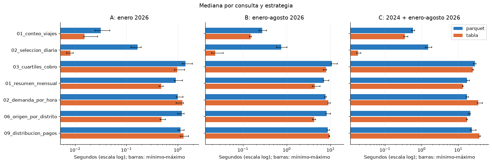
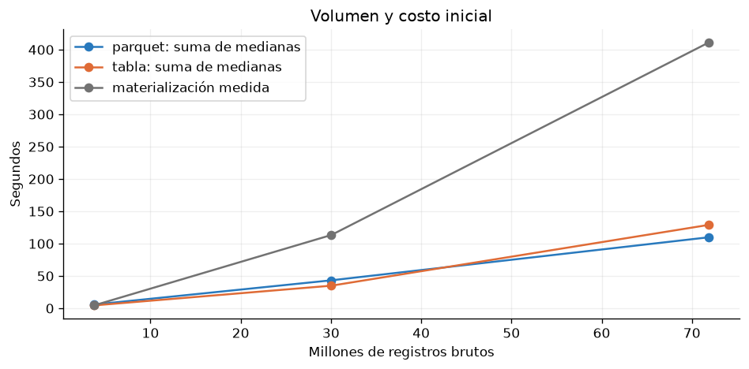
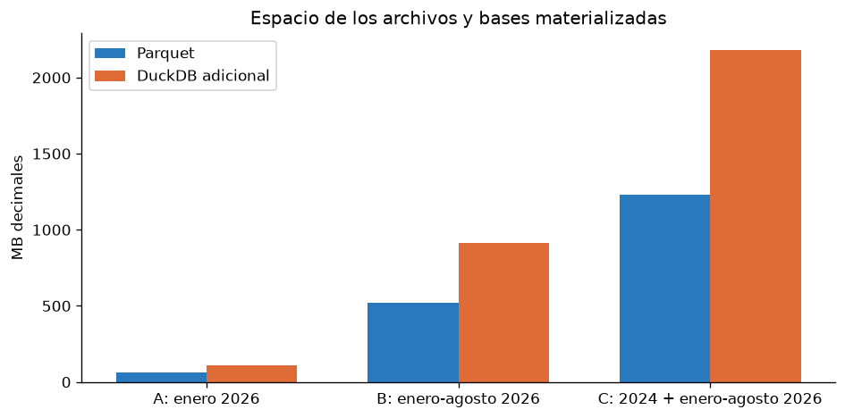

# Ejercicio 6 — Parquet frente a tablas DuckDB

Resumen documental recuperado de los CSV/JSON guardados de la ejecución
`20261013T021526530460Z`. No se volvieron a medir consultas ni a materializar datos.

## Conjuntos y costos iniciales

| Conjunto | Archivos | Registros | Parquet MB | Base MB | Creación s |
|---|---:|---:|---:|---:|---:|
| A: enero 2026 | 2 | 3,765,161 | 65.157 | 110.637 | 4.586 |
| B: enero–agosto 2026 | 16 | 30,040,469 | 519.727 | 915.419 | 113.340 |
| C: 2024 + enero–agosto 2026 | 40 | 71,870,407 | 1,228.649 | 2,182.099 | 411.102 |

Ambos tipos de taxi en cada conjunto; 2025 está excluido. Los conteos y
tamaños proceden de [benchmark_tablas.csv](benchmark_tablas.csv).
Parquet directo usa read_parquet, union_by_name y normalización. La tabla
persistente contiene las mismas filas/columnas normalizadas, sin preagregar,
y aplica las mismas reglas de viajes válidos. La creación se registra por separado.

## SQL y metodología

Se compararon conteo por taxi, selección diaria con promedios, cuartiles
exactos, resumen mensual, demanda por hora, origen por distrito y pagos.
El SQL exacto está registrado en [benchmark.json](benchmark.json), junto con
normalización, filtros, versiones, inventario y hashes de las consultas.
También se conserva en [rendimiento](../../sql/rendimiento/) y
[exploración](../../sql/exploracion/).

DuckDB 1.5.5, Python 3.11.14, Docker/WSL2; dos hilos, buffer de 1 GiB y
temporales limitados a 4 GiB. Una conexión nueva por consulta/estrategia,
un calentamiento y cinco mediciones; execute + fetchall con reloj monotónico.
Estrategias secuenciales, con orden inicial alternado. Las medianas excluyen
el calentamiento. La tabla se creó por mes, con checkpoint y cierre del escritor.

Se conservan **210 mediciones, 42 calentamientos y 21 pares equivalentes**.
Enteros, fechas, texto y nulos se comparan exactamente; floats admiten
tolerancia absoluta de 0.01 y relativa de cero. Evidencia:
[individuales](benchmark_individuales.csv), [resumen](benchmark_tiempos.csv),
[equivalencia](benchmark_equivalencia.csv) y [validación](ejercicio_6_validacion.json).

## Resultados e interpretación

| Conjunto | Suma de medianas Parquet s | Suma de medianas tabla s | Más rápida para la mezcla | Amortización estimada |
|---|---:|---:|---|---|
| A | 5.845 | 4.505 | Tabla | 3.42 rondas |
| B | 43.295 | 34.975 | Tabla | 13.62 rondas |
| C | 109.832 | 129.012 | Parquet | Sin recuperación |

Las sumas representan una ronda estimada de las siete consultas; no son
tiempos de ronda medidos directamente. Cada conjunto tuvo cinco consultas
ganadas por la tabla y dos por Parquet. La razón por consulta es mediana
Parquet / mediana tabla: >1 favorece la tabla, <1 favorece Parquet.
Los resultados completos están en [comparación](benchmark_comparacion.csv)
y [totales](benchmark_totales.csv).

Parquet conviene para exploración y cargas ocasionales que evitan duplicar
almacenamiento. Materializar conviene si una carga repetida amortiza el costo
de creación y mantenimiento. La mezcla de C muestra que una tabla no garantiza
una ventaja global, aunque gane determinadas consultas.

## Recursos y limitaciones

Se comprobaron RAM y disco antes de cada conjunto. Para C se estimaron
24,841,275,136 bytes libres: 256 bytes/fila más 4 GiB de temporales y 2 GiB
de reserva. Es una estimación conservadora, no el tamaño final comprimido.
RSS máximo muestreado: 2.284 GiB; temporales máximos muestreados: 84.7 MiB.
El límite de buffer no cubre toda la memoria del proceso.

No se controló la caché del SO. Materialización previa y orden de ejecución
pueden beneficiar una estrategia; un calentamiento no garantiza caché fría.
Los resultados corresponden a un equipo y almacenamiento local, sin
inferencia universal sobre otros equipos o concurrencia. Los planes
[EXPLAIN](benchmark_planes.json) son apoyo interpretativo, no prueba causal.

## Reproducción explícita en PowerShell

Con los Parquet y el servicio lab existentes, desde la raíz:

```powershell
docker compose exec -T lab python scripts/inventario_benchmark.py
docker compose exec -T lab python -u scripts/medir_rendimiento.py --repeticiones 5 --hilos 2 --memoria 1GiB --conjuntos A B C
docker compose exec -T lab python scripts/documentar_benchmark.py
docker compose exec -T lab jupyter nbconvert --to notebook --execute --inplace notebooks/06_comparacion_rendimiento.ipynb
```

Para presentar la evidencia incluida, basta ejecutar el notebook 06, sin
repetir las mediciones. Las bases de data/processed/benchmark_runs están
excluidas de Git.






